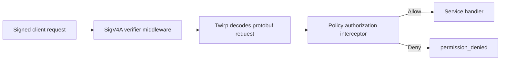

# Integrating a service with iamd policies

A service needs both **authentication** and **authorization**. Signature
verification identifies the caller; the policy evaluator decides whether
that caller can invoke a particular RPC with its decoded protobuf request.
Installing only the signature middleware does not enforce policies.

This guide uses SigV4A and Twirp. The same authorization evaluator can be
called explicitly from another transport after authentication and decoding.
See [IAM policies](iam-policies.md) for document syntax and management.

## Request path



The verifier fetches the caller's public key, identity, and attached policies
from iamd on a cache miss. It caches that response until iamd's
`cache_until`. Authorization then evaluates those policies locally; there
is no per-action authorization RPC to iamd on a warm cache.

## 1. Define your service's protobuf API

The examples below use this illustrative `widgets.proto`:

```proto
syntax = "proto3";
package example.widgets.v1;

option go_package = "example.com/widgets/gen/widgetsv1";

service WidgetService {
  rpc CreateWidget(CreateWidgetReq) returns (CreateWidgetResp);
  rpc ListWidgets(ListWidgetsReq) returns (ListWidgetsResp);
}

message Widget {
  string id = 1;
  string owner_id = 2;
  string name = 3;
}

message CreateWidgetReq {
  string owner_id = 1;
  string name = 2;
}

message CreateWidgetResp {
  Widget widget = 1;
}

message ListWidgetsReq {
  string owner_id = 1;
}

message ListWidgetsResp {
  repeated Widget widgets = 1;
}
```

Generate Go protobuf, Twirp, and gRPC bindings using your project's protobuf
tooling. The code below assumes the generated package is
`example.com/widgets/gen/widgetsv1`; the gRPC binding supplies the full
service-name descriptor, but this guide does not mount a gRPC listener.
Replace that import and the generated types with your own API's bindings.

No protobuf schema registration in iamd is required. The enforcing service
knows its request types and compiles the CEL filters against them. iamd
checks policy fields, CEL boolean results, and the concrete principal type
before it stores a document. Request fields remain dynamic during this
check because iamd does not know every service's schemas.

## 2. Provision a backend credential

Use separate, non-admin IAM users for the backend and its callers:

| Credential                  | Used for                                       | Required grant                     |
| --------------------------- | ---------------------------------------------- | ---------------------------------- |
| Backend/verifier credential | The service's `GetPublicKey` requests to iamd  | `sts-sigv4a-verifier` policy       |
| Caller credential           | The end user's signed requests to your service | A policy granting your RPC methods |

Create those users using an administrator's IAM CLI configuration:

```sh
iam --config admin.hcl users create --name widgets-verifier
iam --config admin.hcl users create --name alice
```

Save each returned secret: it is issued only once. Load the backend secret
from your service's secret-management mechanism, and do not log it. Replace
`<backend-user-id>` below with the backend user's returned UUID:

```sh
VERIFIER_POLICY_ID=$(iam policies templates render sts-sigv4a-verifier --name widgets-verifier-lookup |
  iam --config admin.hcl policies create --file -)
iam --config admin.hcl policies attach "$VERIFIER_POLICY_ID" --user-id <backend-user-id>
```

That policy lets the backend fetch incoming callers' public keys and their
identity/policy metadata. It does not grant end users any widget operations.
Grant lookup access only to trusted backends. Do not use an admin credential
as an end-user credential: `is_admin` bypasses policy evaluation, including
explicit denies, in downstream services too.

## 3. Install authentication and authorization

The following server-wiring file accepts your existing `WidgetService`
implementation as `svc`:

```go
package widgets

import (
    "context"
    "net/http"
    "time"

    "github.com/twitchtv/twirp"
    widgetsv1 "example.com/widgets/gen/widgetsv1"
    stsv1 "within.website/x/gen/within/website/x/iam/sts/v1"
    "within.website/x/iam/authz"
    "within.website/x/web/middleware/authctx"
    "within.website/x/web/middleware/sigv4a/iamsts"
    "within.website/x/web/middleware/sigv4a/sigv4aclient"
)

type Config struct {
    IAMURL                 string
    IAMRegion              string
    IAMService             string
    AppRegion              string
    BackendAccessKeyID     string
    BackendSecretAccessKey string
}

func NewMux(cfg Config, svc widgetsv1.WidgetService) (*http.ServeMux, error) {
    transport, err := sigv4aclient.NewSigV4ARoundTripper(
        &sigv4aclient.Config{
            Region:      cfg.IAMRegion,
            ServiceName: cfg.IAMService,
            AccessKey:   cfg.BackendAccessKeyID,
            SecretKey:   cfg.BackendSecretAccessKey,
        },
        nil,
    )
    if err != nil {
        return nil, err
    }

    verifier := iamsts.New(iamsts.Config{
        BaseURL:     cfg.IAMURL,
        HTTPClient:  &http.Client{Transport: transport, Timeout: 10 * time.Second},
        Region:      cfg.AppRegion,
        Service:     "widgets",
        MaxBodySize: 1 << 20,
    })

    evaluator, err := authz.New(map[string]interface{}{
        authz.MethodName(widgetsv1.WidgetService_ServiceDesc.ServiceName, "CreateWidget"): &widgetsv1.CreateWidgetReq{},
        authz.MethodName(widgetsv1.WidgetService_ServiceDesc.ServiceName, "ListWidgets"): &widgetsv1.ListWidgetsReq{},
    })
    if err != nil {
        return nil, err
    }

    names := map[string]string{
        "WidgetService": widgetsv1.WidgetService_ServiceDesc.ServiceName,
    }
    handler := widgetsv1.NewWidgetServiceServer(
        svc,
        twirp.WithServerInterceptors(
            policyInterceptor(evaluator, names),
        ),
    )

    mux := http.NewServeMux()
    mux.Handle(widgetsv1.WidgetServicePathPrefix, verifier.Middleware(handler))
    return mux, nil
}

func policyInterceptor(evaluator *authz.Evaluator, names map[string]string) twirp.Interceptor {
    return func(next twirp.Method) twirp.Method {
        return func(ctx context.Context, req interface{}) (interface{}, error) {
            service, _ := twirp.ServiceName(ctx)
            method, _ := twirp.MethodName(ctx)
            if err := authorizeCaller(ctx, evaluator, authz.MethodName(names[service], method), req); err != nil {
                return nil, err
            }
            return next(ctx, req)
        }
    }
}

func authorizeCaller(ctx context.Context, evaluator *authz.Evaluator, method string, req interface{}) error {
    caller, ok := authctx.Caller(ctx)
    if !ok || caller == nil {
        return twirp.NewError(twirp.Unauthenticated, "no verified caller in context")
    }
    policies, _ := authctx.PrincipalPolicies(ctx)
    principal := &stsv1.TokenIdentity{
        AccessKeyId:    caller.AccessKeyID,
        OrganizationId: caller.OrganizationID,
        PrincipalId:    caller.PrincipalID,
        DisplayName:    caller.DisplayName,
        IsAdmin:        caller.IsAdmin,
    }
    decision := evaluator.Check(policies, method, req, principal)
    if !decision.Allowed {
        return twirp.NewError(twirp.PermissionDenied, decision.Reason)
    }
    return nil
}
```

Set `IAMURL` to your trusted iamd endpoint, using HTTPS outside local
development. The response contains authorization data; its integrity matters
just as much as the integrity of the incoming request. `IAMRegion` and
`IAMService` must match iamd's own `-region` and `-service` settings. The
checked-in deployment uses region `yow`; iamd's default service name is
`iam`.

`AppRegion` and the `widgets` signing scope belong to your application.
They must match what its clients sign, and need not match iamd's scope.
The signing-scope string `widgets` is distinct from the full policy method
name `example.widgets.v1.WidgetService/CreateWidget`.

Register every guarded method with its full name and a sample request
message. The evaluator checks request fields against that method's concrete
protobuf type. An unregistered method fails closed for non-admin callers.

Include every mounted service in `names`. Twirp supplies short names such
as `WidgetService`, while policy patterns match full protobuf service names.

Share the verifier and evaluator across routes instead of constructing them
for each request. Mount each protected RPC service with both layers. Do not
also expose an unwrapped copy of the same handler.

## 4. Give the caller an action policy

Save this as `widgets-user.json`. It permits the caller to create widgets
for itself and request its own listing:

```json
{
  "name": "own-widgets",
  "statements": [
    {
      "effect": "EFFECT_ALLOW",
      "methods": [
        "example.widgets.v1.WidgetService/CreateWidget",
        "example.widgets.v1.WidgetService/ListWidgets"
      ],
      "filter": "req.owner_id == principal.principal_id"
    }
  ]
}
```

Both request types deliberately have an `owner_id` field, so this filter can
compile for both methods. `principal.principal_id` is the authenticated
caller's IAM user UUID, not a caller-supplied request value.

Using admin credentials, attach this policy to the caller's user, not the
backend's verifier user:

```sh
iam policies validate --file widgets-user.json
CALLER_POLICY_ID=$(iam --config admin.hcl policies create --file widgets-user.json)
iam --config admin.hcl policies attach "$CALLER_POLICY_ID" --user-id <caller-user-id>
```

An ordinary caller with no applicable allow is denied. Across attached
policies, an applicable explicit deny overrides an allow. Admin callers
bypass this evaluation. A broken ALLOW filter grants nothing; a broken DENY
filter denies the matching method. Server-side request validation is still
your responsibility, including for admins.

## 5. Sign client requests for your service

The caller uses its own credential, not the backend's credential. This
client-wiring file returns the generated Twirp client:

```go
package widgets

import (
    "net/http"
    "time"

    widgetsv1 "example.com/widgets/gen/widgetsv1"
    "within.website/x/web/middleware/sigv4a/sigv4aclient"
)

func NewClient(endpoint, region, accessKeyID, secretAccessKey string) (widgetsv1.WidgetService, error) {
    transport, err := sigv4aclient.NewSigV4ARoundTripper(
        &sigv4aclient.Config{
            Region:      region,
            ServiceName: "widgets",
            AccessKey:   accessKeyID,
            SecretKey:   secretAccessKey,
        },
        nil,
    )
    if err != nil {
        return nil, err
    }
    return widgetsv1.NewWidgetServiceProtobufClient(
        endpoint,
        &http.Client{Transport: transport, Timeout: 10 * time.Second},
    ), nil
}
```

Pass the same region used by the server's `AppRegion`. For this policy,
`CreateWidgetReq.OwnerId` and `ListWidgetsReq.OwnerId` must equal the
caller's UUID. The interceptor returns `permission_denied` before calling
`svc` when the policy does not allow the request.

## 6. Keep business and resource checks in the handler

The interceptor gates method invocation; it does not implement your data
model or modify a database query. Your handler must still:

- Validate the request and enforce business invariants.
- Use the authorized `owner_id` when storing and listing widgets. Allowing
  a list RPC does not automatically restrict which rows it returns.
- Resolve resource ownership from trusted storage when the request contains
  only a resource ID. A supplied owner field does not prove the referenced
  resource actually belongs to that owner.
- Read the verified caller with `authctx.Caller(ctx)` when it needs identity
  for query scoping or audit attribution. Do not trust request identity
  fields in place of that caller.

The verifier stores identity through `authctx.Caller` and policies through
`authctx.PrincipalPolicies`. The example's `authorizeCaller` helper reads
both values and calls `Evaluator.Check`. This check preserves the admin
bypass. Without policies, a non-admin caller receives an implicit denial.
The Twirp interceptor calls this helper before the handler.

## Other transports or explicit checks

For a custom HTTP dispatcher, Connect interceptor, or gRPC interceptor,
authenticate through the transport's authentication layer. Then decode the
request and call `authorizeCaller` before any side effects. This example
uses the helper from the server example:

```go
package widgets

import (
    "context"

    widgetsv1 "example.com/widgets/gen/widgetsv1"
    "within.website/x/iam/authz"
)

func AuthorizeCreateWidget(ctx context.Context, evaluator *authz.Evaluator, req *widgetsv1.CreateWidgetReq) error {
    return authorizeCaller(ctx, evaluator, "example.widgets.v1.WidgetService/CreateWidget", req)
}
```

A missing verified caller is denied. The Twirp error above is suitable for
Twirp/custom Twirp-style HTTP responses; map denials to your own transport's
permission-denied error for Connect or gRPC. There is currently no supplied
Connect/gRPC authorization adapter. The HTTP SigV4A middleware is not a
native gRPC authentication interceptor.

Do not expose another listener or route that reaches the same operations
without equivalent authentication and authorization. Direct in-process
calls to `svc` bypass the Twirp interceptor too. Attachments in iamd alone
do not secure a service that has not installed enforcement.

## Cache behavior and verification checklist

Downstream grants, detaches, disabled credentials, and admin-state changes
can remain stale until the server-advised key-cache TTL expires. Plan for
that revocation delay. Warm cached entries work during an iamd outage.
Failed requests for uncached or expired keys fail closed.

Signature verification does not prevent replay within the accepted timestamp
window. If your application requires replay protection, add an idempotency
or replay mechanism.

Before exposing the service, exercise it with non-admin credentials:

1. An unsigned request does not reach the handler.
2. A signed caller with no grant receives `permission_denied`.
3. The caller policy permits creating and listing widgets for its own UUID.
4. Requests naming another owner are denied before reaching the handler.
5. A matching DENY overrides an ALLOW from another attached policy.
6. Detaching the grant takes effect after the cached policy response expires.
7. An ungranted method and every alternative transport remain protected.

The shared entrypoints are
[`authz.Evaluator.Check`](../iam/authz/authz.go) and
[`sigv4a/iamsts.Verifier`](../web/middleware/sigv4a/iamsts/iamsts.go).
The interceptor and context helper in this guide belong to your service.
